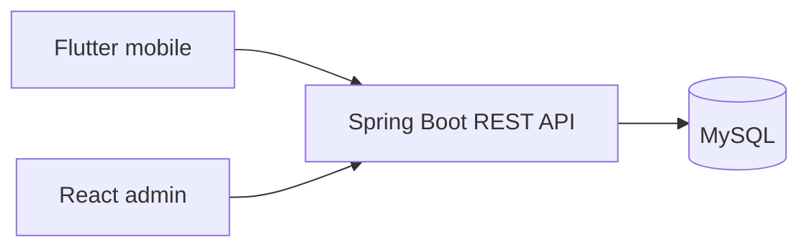

# SmartTravel

**SmartTravel** là dự án hỗ trợ khám phá địa điểm và lập lịch trình du lịch cá nhân hóa tại Đà Nẵng. Du khách chọn ngày đi, số người, ngân sách, sở thích và phương tiện; hệ thống đề xuất các điểm dừng, sắp xếp thời gian, ước tính chi phí hoạt động và hiển thị lộ trình trên bản đồ.

Dự án gồm ứng dụng Flutter cho du khách, REST API Spring Boot và trang quản trị React để quản lý dữ liệu, tài khoản và nội dung đánh giá.

## Chức năng chính

### Dành cho du khách

- **Tài khoản và hồ sơ:** đăng ký, đăng nhập, đặt lại mật khẩu, lưu ngôn ngữ/sở thích/mặc định chuyến đi và xóa tài khoản.
- **Khám phá địa điểm:** tìm kiếm, lọc danh mục và khoảng giá; xem ảnh, mô tả, giờ mở cửa, thời lượng tham quan và đánh giá.
- **Yêu thích:** lưu/bỏ lưu địa điểm theo tài khoản, chọn điểm đã lưu khi tạo chuyến.
- **Tạo lịch trình:** chuyến 1–7 ngày, nhóm 1–10 người; chọn điểm bắt buộc hoặc loại trừ và điểm xuất phát.
- **Xem và chỉnh sửa:** timeline theo ngày, bản đồ, dự toán nhóm và phân bổ theo danh mục; thêm/xóa/thay/đổi thứ tự hoạt động, sửa giờ, thời lượng và ghi chú.
- **Quản lý chuyến:** lưu bản nháp, đổi tên, sao chép, xóa, tìm lịch sử và chia sẻ liên kết chỉ đọc có thể thu hồi.
- **Đánh giá và thời tiết:** viết đánh giá địa điểm, báo cáo nội dung; xem thông tin thời tiết với trạng thái độ mới rõ ràng.

### Dành cho quản trị viên

- Dashboard lấy số liệu từ database.
- Quản lý danh mục, địa điểm, ảnh, bản dịch, giá, giờ tuần và thời lượng tham quan.
- Quản lý tài khoản, vai trò và trạng thái khóa; tra cứu lịch trình đã lưu theo quyền.
- Tiếp nhận báo cáo, ẩn/hiện đánh giá; tra cứu và xuất nhật ký thao tác.

## Cơ chế gợi ý lịch trình

Bộ gợi ý dùng **chấm điểm theo nội dung, chèn tham lam và tìm kiếm cục bộ**. Lựa chọn của từng chuyến được ưu tiên hơn mặc định hồ sơ. Hệ thống lọc địa điểm khả dụng, xét sở thích và điểm tiêu biểu, rồi kiểm tra giờ mở cửa, vị trí, thời gian đi, nhịp độ và ngân sách khi xếp lịch.

Kết quả có lý do đề xuất và cảnh báo. Nếu không thể đáp ứng đầy đủ, hệ thống trả kết quả một phần hoặc hướng dẫn điều chỉnh. Phiên bản hiện tại không gọi LLM để quyết định lịch trình.

Chi tiết: [Tạo lịch trình và cá nhân hóa](docs/reports/features/itinerary-generation.md).

## Phạm vi dữ liệu

Catalog tập trung vào sáu nhóm: **biển, ăn uống, văn hóa, check-in, cà phê và vui chơi buổi tối** tại Đà Nẵng.

- Dự toán tính tiền hoạt động cho cả nhóm theo giá mỗi người/lần ghé; không gồm lưu trú hoặc di chuyển. Thời gian và khoảng cách di chuyển vẫn được dùng để kiểm tra lịch.
- Giá chưa biết được giữ là `NULL`, khác với miễn phí. Đánh giá Google Maps và đánh giá SmartTravel được hiển thị riêng.
- Tuyến từ nhà cung cấp, cache, ước tính Haversine và dữ liệu chưa biết được phân biệt; không vẽ đường ước tính như đường giao thông thật.
- Database hiện có **12 bảng**, khởi tạo bằng chuỗi Flyway **V1–V8**. Cấu trúc từng nằm trong V11/V12 đã được gộp vào V1.

Xem [schema và ý nghĩa dữ liệu](docs/architecture/database-schema.md), [ERD](docs/architecture/erd/smarttravel.mmd) và [giới hạn nâng cấp baseline](docs/reports/engineering/database-baseline.md).

## Công nghệ và kiến trúc

| Thành phần | Công nghệ |
| --- | --- |
| Backend | Java 21, Spring Boot 3.5.5, Spring Security/JWT, Spring Data JPA, Flyway |
| Mobile | Flutter/Dart, Material 3, Riverpod, GoRouter, Dio, flutter_map |
| Admin | React 19, TypeScript, Vite |
| Database | MySQL; Docker Compose cấu hình MySQL 8.4 |
| Tích hợp | Adapter định tuyến OSRM, thời tiết Open-Meteo và email reset mật khẩu |



Backend tổ chức theo feature với các lớp API, DTO, service, repository và domain. Hai client dùng hợp đồng dữ liệu chung; phân quyền, kiểm tra đầu vào và tính toán chuyến đi thực hiện phía server. Xem [kiến trúc hệ thống](docs/architecture/system-architecture.md).

## Cấu trúc repository

```text
smarttravel/
  backend/       REST API, nghiệp vụ, migration và kiểm thử tích hợp
  mobile/        Ứng dụng dành cho du khách
  admin/         Giao diện quản trị
  docs/          Kiến trúc, hướng dẫn, trạng thái và báo cáo theo chủ đề
  tasks/         PRD, user stories và tài liệu thiết kế
  .github/       Workflow CI
```

## Khởi chạy cục bộ

Cần Java 21, Maven, Node.js/npm, Flutter SDK và MySQL hoặc Docker Compose. Bộ test admin gần nhất dùng Node 24; phiên bản Dart yêu cầu xem [pubspec.yaml](mobile/pubspec.yaml). Với mobile, ưu tiên thiết bị Android bật USB debugging.

### 1. Chuẩn bị database

Từ gốc repository, tạo file cấu hình local và chỉnh giá trị theo môi trường:

```powershell
if (-not (Test-Path .env)) { Copy-Item .env.example .env }
docker compose up -d mysql
```

Không ghi đè `.env` đang dùng. File này được Docker Compose đọc; Maven, Flutter và Vite không tự nhận toàn bộ các biến trong đó.

### 2. Chạy backend

Trong terminal riêng, cấp các biến datasource khớp tài khoản database đã chuẩn bị. Ví dụ PowerShell với cấu hình local mặc định:

```powershell
cd backend
$databaseAccount = Get-Credential -UserName 'smarttravel'
$env:SPRING_DATASOURCE_URL = 'jdbc:mysql://localhost:3306/smarttravel?useSSL=false&allowPublicKeyRetrieval=true&serverTimezone=UTC'
$env:SPRING_DATASOURCE_USERNAME = $databaseAccount.UserName
$env:SPRING_DATASOURCE_PASSWORD = $databaseAccount.GetNetworkCredential().Password
mvn spring-boot:run
```

Cấp thêm `JWT_SECRET` riêng tối thiểu 32 byte UTF-8 để giữ phiên qua restart. Nếu bỏ trống, backend dùng khóa ngẫu nhiên mỗi lần khởi động. Khởi tạo admin được điều khiển bằng nhóm biến `BOOTSTRAP_ADMIN_*` trong [.env.example](.env.example); đăng ký thông thường không cấp quyền admin.

API mặc định: `http://localhost:8080/api/v1`. Health check: `GET /api/v1/health`.

### 3. Chạy trang quản trị

Trong terminal riêng, từ gốc repository:

```powershell
cd admin
npm ci
npm run dev
```

Mở địa chỉ Vite hiển thị trong terminal, mặc định `http://localhost:5173`. Nếu backend ở địa chỉ khác, cấp `VITE_API_BASE_URL`; cấu hình CORS backend phải cho phép origin admin thực tế.

### 4. Chạy mobile

Trong terminal riêng, từ gốc repository, với Android đã kết nối USB và `adb` có trong PATH:

```powershell
cd mobile
flutter pub get
adb reverse tcp:8080 tcp:8080
flutter run --dart-define=API_BASE_URL=http://127.0.0.1:8080/api/v1
```

Khi dùng Wi-Fi hoặc môi trường khác, đổi `API_BASE_URL` thành địa chỉ thiết bị truy cập được. Hướng dẫn cấu hình, database test và các cách chạy khác nằm trong [runbook](docs/development/testing-runbook.md).

## Kiểm thử

Chạy từ thư mục tương ứng; backend phải dùng database `smarttravel_test` riêng theo runbook, không trỏ vào DB phát triển:

| Thành phần | Lệnh |
| --- | --- |
| Backend | `mvn test` |
| Mobile | `flutter analyze` và `flutter test` |
| Admin | `npm run build`, `npm run test:destinations`, `npm run test:security` |
| Toàn bộ file test admin | `node --experimental-vm-modules --test tests/*.test.mjs` |

## Trạng thái triển khai

Các luồng chính đã có mã triển khai và báo cáo kiểm thử. Dự án vẫn còn các phần cần nghiệm thu: Android native/E2E, kênh email thật, endpoint định tuyến được duyệt, thu thập Google định kỳ, hiệu năng/usability và vận hành database. Chưa xác nhận hỗ trợ iOS hoặc Flutter web.

MySQL 8.4 là cấu hình Compose/CI; các báo cáo backend gần nhất dùng MySQL 9.2 cô lập. Database đã chạy baseline cũ cần kế hoạch chuyển đổi riêng, không tự `repair` hoặc xóa lịch sử Flyway.

Theo dõi chi tiết tại [trạng thái yêu cầu](docs/planning/requirements-status.md) và [kế hoạch nghiệm thu](docs/planning/completion-plan.md). Không dùng build qua hoặc browser fixture để thay bằng chứng phát hành.

## Tài liệu dự án

| Nội dung | Tài liệu |
| --- | --- |
| Mục lục tài liệu | [docs/README.md](docs/README.md) |
| Tổng quan mã nguồn | [Codebase summary](docs/codebase-summary.md) |
| Yêu cầu sản phẩm | [PRD](tasks/prd-smarttravel.md), [user stories](tasks/smarttravel-user-stories.md) |
| Báo cáo theo chức năng | [Mục lục báo cáo](docs/reports/README.md) |
| Quy trình phát triển | [Quy chuẩn](docs/development/code-standards.md), [workflow](docs/development/agent-workflow.md), [CONTRIBUTING](CONTRIBUTING.md) |
