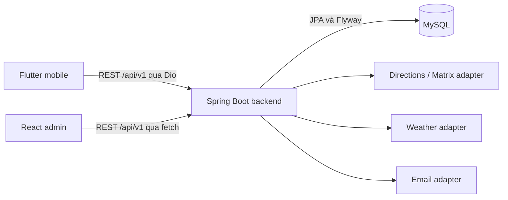

# Kiến trúc hệ thống SmartTravel

Mô tả hiện hành theo mã nguồn ngày 16/11/2026. [Tổng quan](../codebase-summary.md) trình bày chức năng; [trạng thái yêu cầu](../planning/requirements-status.md) ghi mức nghiệm thu.

## Các tầng



| Tầng | Tổ chức và trách nhiệm |
| --- | --- |
| Backend | Java 21, Spring Boot 3.5.5. `features/<feature>/{api,domain,dto,repository,service}`; `common/` chứa envelope, xử lý lỗi, bảo mật và upload |
| Mobile | Flutter/Material 3, Riverpod, GoRouter, Dio. Feature-first: `data/models`, `data/repositories`, `presentation/providers`, `presentation/screens`; `core/` chứa router/theme/network/localization |
| Admin | React 19, TypeScript strict, Vite. `features/` chứa màn nghiệp vụ, `core/` chứa API/session/language, `components/` chứa shell/form dùng chung, `types/` chứa DTO |
| Database | 12 bảng trong V1 hiện tại; `ddl-auto=validate`. Chi tiết trong [schema](database-schema.md), [ERD](erd/smarttravel.mmd) và [SQL](../../backend/src/main/resources/db/migration) |

## Hợp đồng HTTP và bảo mật

API JSON dùng [ApiResponse](../../backend/src/main/java/com/smarttravel/backend/common/ApiResponse.java), gồm `success`, `message`, `data`, `errors`, `timestamp`. Ví dụ lỗi:

```json
{
  "success": false,
  "message": "Validation failed",
  "data": null,
  "errors": ["name must not be blank"],
  "timestamp": "2026-11-16T00:00:00Z"
}
```

`errors` có thể NULL. HTTP status vẫn phản ánh lỗi; client không được chỉ dựa vào việc parse được JSON để báo thành công. CSV audit và trang HTML chia sẻ là response theo media type riêng, không bọc JSON.

JWT gắn danh tính và auth version. Controller/service kiểm tra chủ sở hữu, role và trạng thái tài khoản; client chỉ ẩn/hiện nút không thay việc kiểm quyền server. Đăng xuất/401 xóa dữ liệu riêng của phiên, 403 không tạo phiên mới. Reset/đổi mật khẩu và thay đổi quyền/trạng thái có cơ chế thu hồi phiên. Xem [bảo mật và hồ sơ](../reports/features/accounts.md).

## Các luồng chính

| Luồng | Dữ liệu và xử lý |
| --- | --- |
| Khám phá | Category/địa điểm ACTIVE trong phạm vi; tìm Việt/Anh, lọc category/giá, phân trang. Giá NULL không được hiểu là miễn phí |
| Tạo chuyến | Wizard lấy mặc định hồ sơ; server xác thực ngày 1–7, khách 1–10, ngân sách, sở thích, origin và required/excluded. Generation key chống tạo trùng, lưu input/snapshot cùng DRAFT |
| Gợi ý | Chấm điểm theo nội dung và sở thích chuyến ưu tiên hơn hồ sơ; xét điểm tiêu biểu, giờ tuần, địa lý, pace, bữa ăn và giá. Chèn tham lam/tìm kiếm cục bộ trả COMPLETE/PARTIAL cùng lý do/cảnh báo; không dùng LLM |
| Chỉnh sửa | Kiểm ownership ngày/item và version. Giữ snapshot khi sửa ghi chú, lấy catalog mới khi thay điểm; dùng chung calculator/route, cộng lại đủ mọi ngày |
| Lưu/chia sẻ | DRAFT chuyển SAVED theo thao tác lưu. Copy tạo dữ liệu độc lập, không sao token. Public share chỉ đọc, có thu hồi/thay/hết hạn, bỏ dữ liệu tài khoản riêng |
| Đánh giá | Một review/user/điểm; chỉ PUBLISHED tính AVG/COUNT. Số Google giữ riêng, không cộng vào số SmartTravel |
| Quản trị | Catalog xóa mềm; user/role/lock bảo vệ admin cuối cùng. Audit và thay đổi commit/rollback cùng transaction; dashboard/audit đọc DB |

Chi tiết thuật toán và vòng đời nằm trong [REC](../reports/features/itinerary-generation.md#cơ-chế-gợi-ý-cá-nhân-hóa), [TRIP](../reports/features/itinerary-generation.md#đầu-vào-và-bản-nháp), [EDIT](../reports/features/itinerary-management.md#chỉnh-sửa-và-tính-lại), [SHARE](../reports/features/itinerary-management.md#lưu-trữ-sao-chép-và-chia-sẻ).

## Dịch vụ ngoài và suy giảm dữ liệu

- Route adapter hỗ trợ OSRM Directions/Matrix, timeout/cache/quota; URL mặc định để trống. PROVIDER/CACHE giữ hình học thật, HAVERSINE là ước tính, UNKNOWN giữ NULL. Nghiệm thu endpoint thật còn mở. [MAP](../reports/features/routing-and-maps.md)
- Thời tiết qua backend, kiểm timezone/locale và có FRESH/CACHED/STALE/UNAVAILABLE. Không gọi dữ liệu mô hình là quan trắc trực tiếp. [WEATHER](../reports/features/weather.md)
- Reset dùng email adapter, token hash có hạn và dùng một lần. Test HTTP local đã ghi nhận; hộp thư thật cần nghiệm thu. [USER/AUTH](../reports/features/accounts.md)
- Ngôn ngữ mobile/admin dùng hồ sơ và tài nguyên chung `mobile/assets/translations/en.json`; thiếu bản dịch dữ liệu thì fallback Việt. [UX](../reports/experience/localization-and-accessibility.md)

Không có booking/HOTEL, tính tiền di chuyển/lưu trú, OAuth, chatbot, undo revision hoặc bảng tag độc lập trong MVP. Giới hạn phát hành được quản lý ở [trạng thái yêu cầu](../planning/requirements-status.md), không suy ra từ số bảng hoặc số màn hình.
